<a class="video-button" href="https://youtu.be/_dcauZC9ST8" target="_blank" rel="noopener">▶ Watch the video</a>

[In the loop, not in the dark: staying in control in the era of dark software factories](https://m.devoxx.com/events/dvbe26/talks/52104/in-the-loop-not-in-the-dark-staying-in-control-in-the-era-of-dark-software-factories) by [Alex Gavrilescu](https://m.devoxx.com/events/dvbe26/speaker/24199/alex-gavrilescu)  
Room 4 · Conference · 09:30-10:20

## Summary

After Backlog.md enabled agents to generate 300,000 lines with limited oversight, Groma.md restores architectural ownership. It maintains a real-time project blueprint as the source of truth, guiding agent-driven implementation while keeping humans focused on meaningful design decisions. A live demonstration will map a large open-source repository into Groma.

## Timeline

- Framework for Sofware Factory
- Backlog.md

### [02:00](https://youtu.be/_dcauZC9ST8?t=120)
- stop code Review => until error hit me

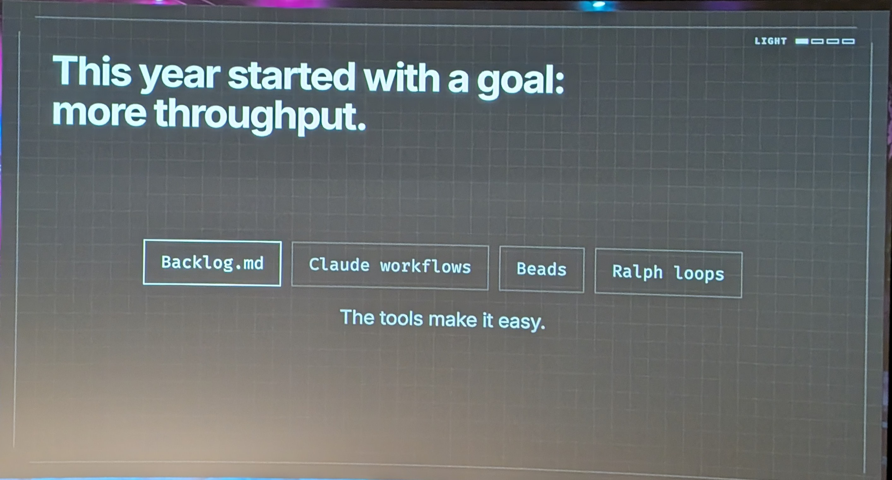

### [07:00](https://youtu.be/_dcauZC9ST8?t=420)
- what is my role

### [08:00](https://youtu.be/_dcauZC9ST8?t=480)
- Review the vibe coded App

### [12:00](https://youtu.be/_dcauZC9ST8?t=720)
- with first fix it still doesn't work

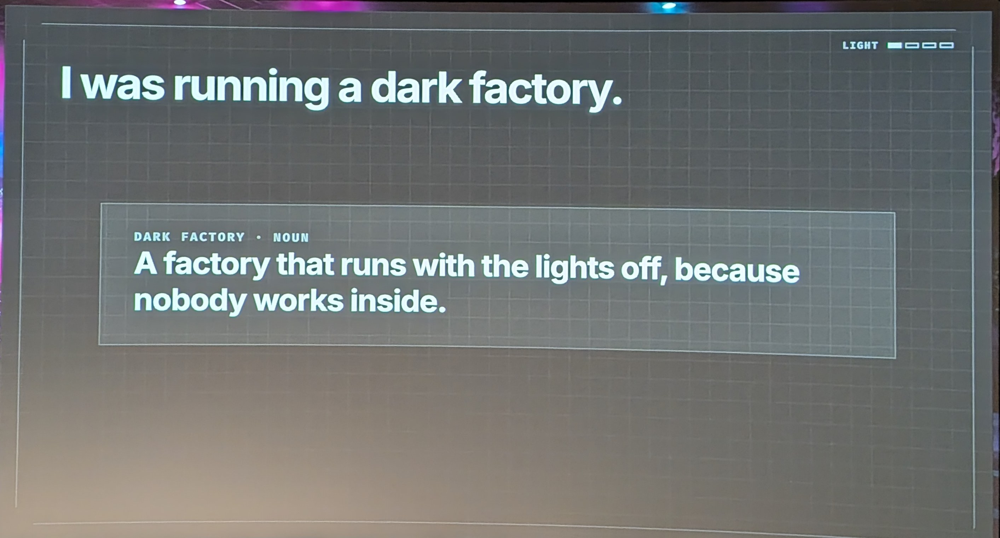

### [14:00](https://youtu.be/_dcauZC9ST8?t=840)
- groma.md 3rd Attend [?]

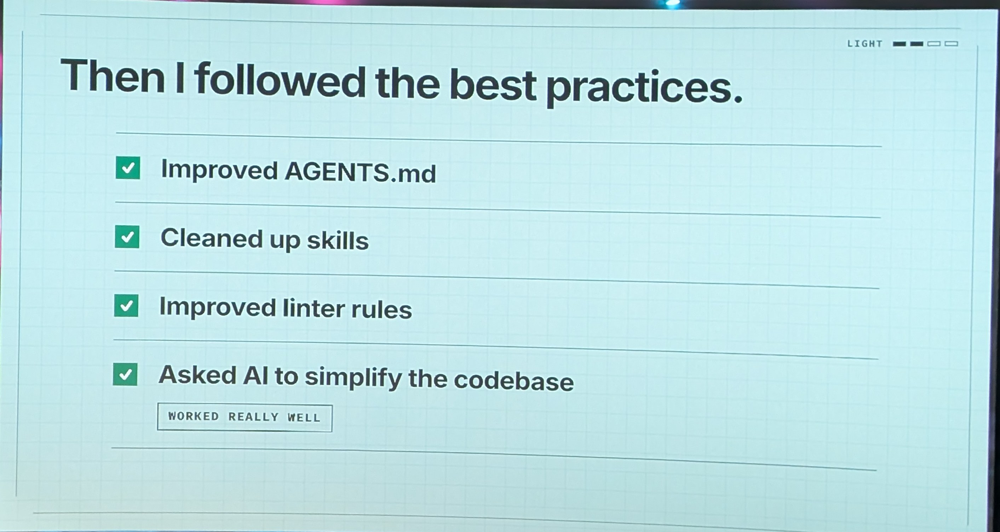

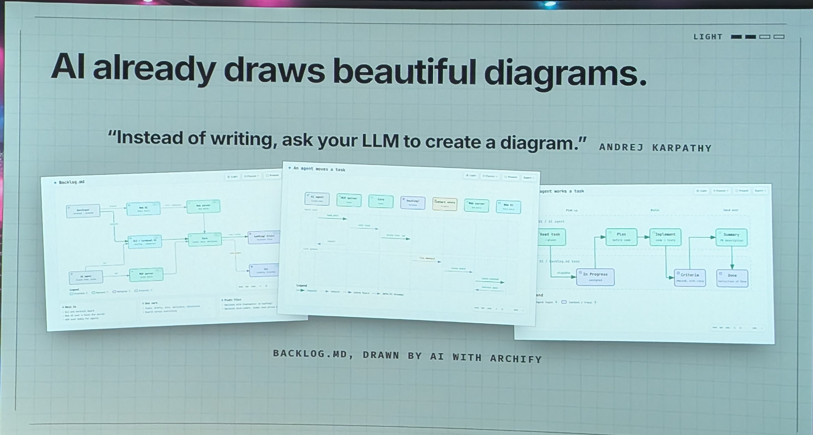

### [19:34](https://youtu.be/_dcauZC9ST8?t=1174)

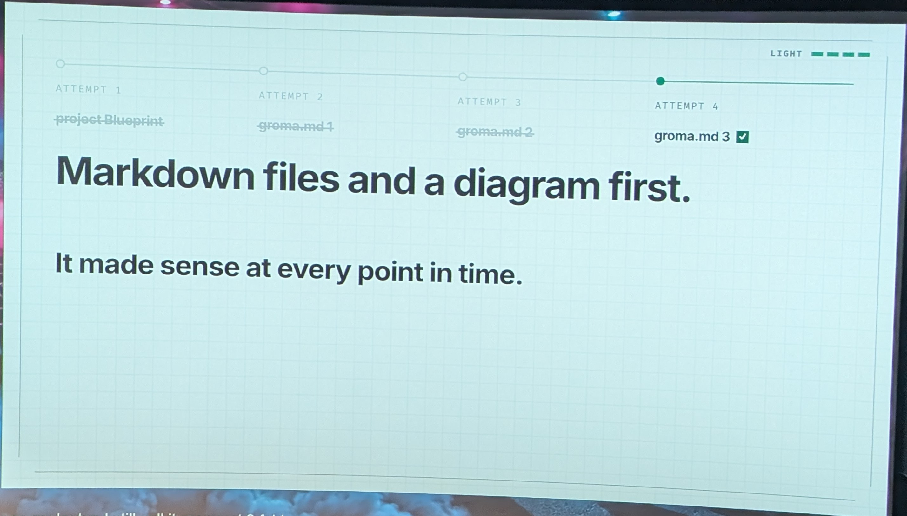

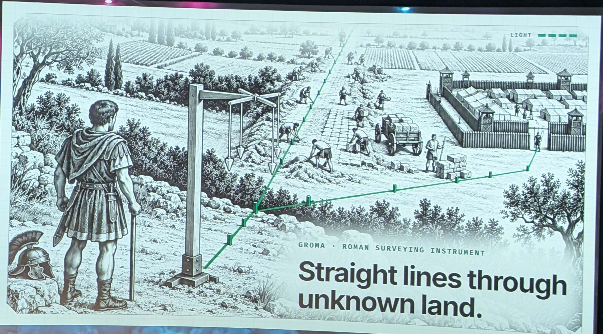

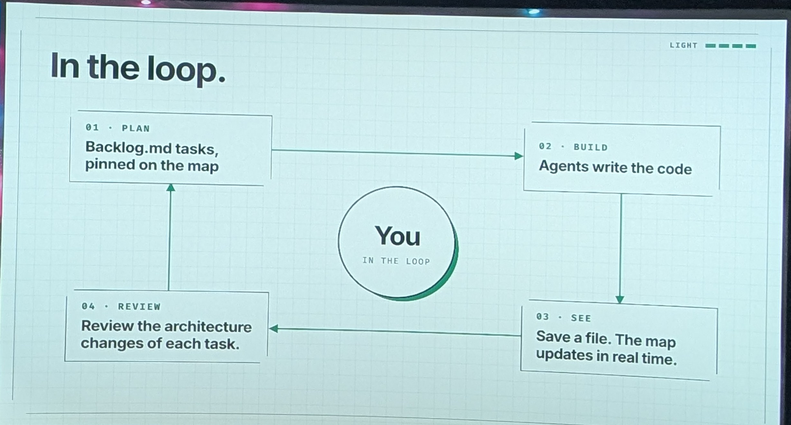

### [28:32](https://youtu.be/_dcauZC9ST8?t=1712)

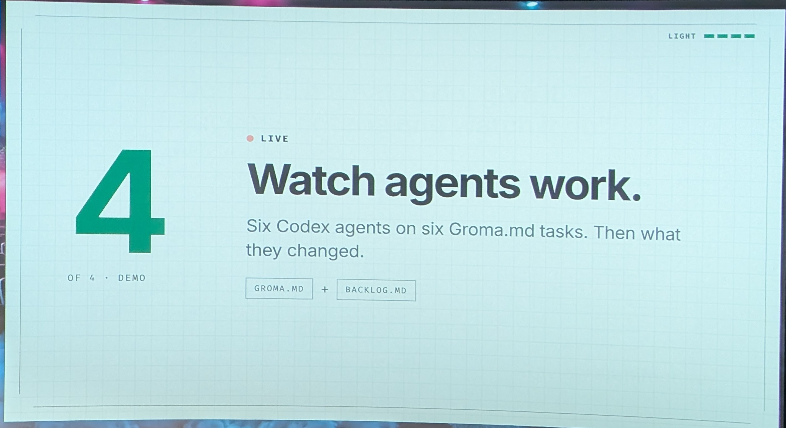

### [32:47](https://youtu.be/_dcauZC9ST8?t=1967)

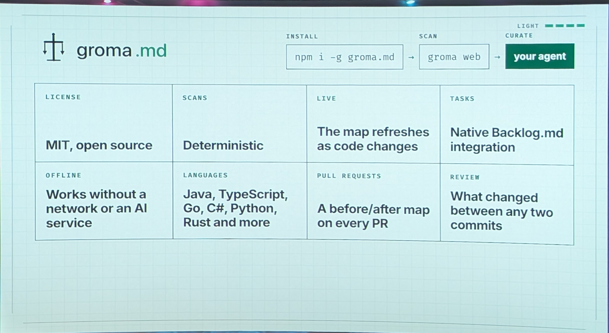

### [36:16](https://youtu.be/_dcauZC9ST8?t=2176)

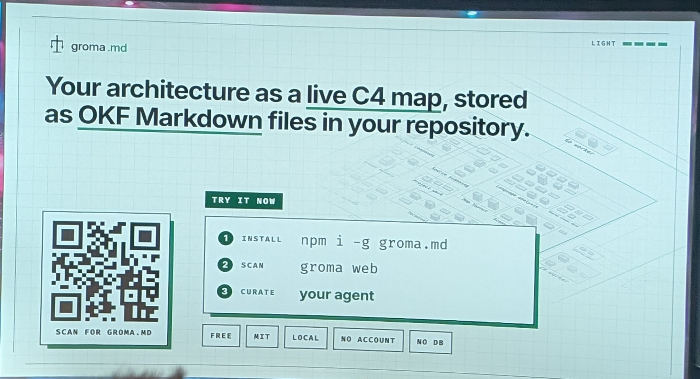

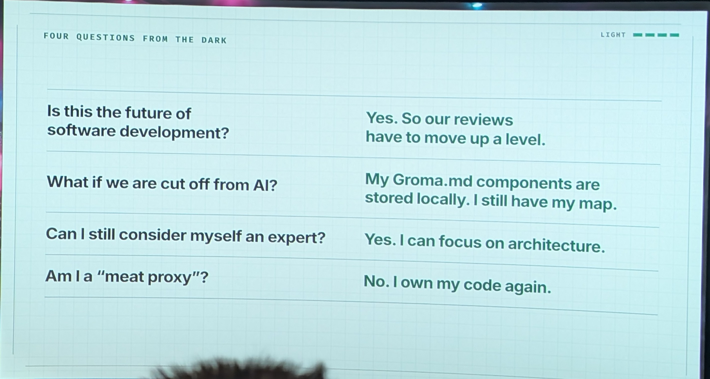
