[Is AI killing XP practices? (Or are we letting it?)](https://m.devoxx.com/events/dvbe26/talks/15359/is-ai-killing-xp-practices-or-are-we-letting-it) by [Nacho Cougil](https://m.devoxx.com/events/dvbe26/speaker/15309/nacho-cougil)  
Room 5 · Conference · 10:40-11:30

## Summary

AI can tempt teams to skip core XP practices like TDD, refactoring, pair programming, and CI. This session shows why these habits are at risk in AI-assisted development, what breaks when they’re ignored, and why they matter even more as AI accelerates both good and bad engineering.

## Timeline

### 07:00
- WaterFall

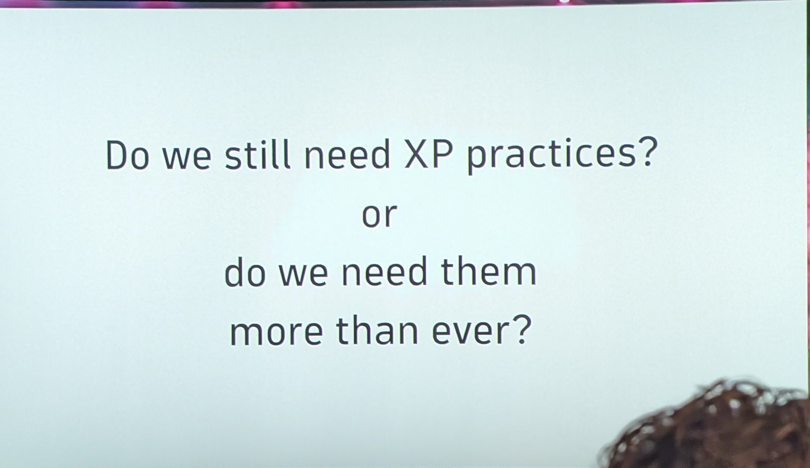

### 08:00
- 7 Principle

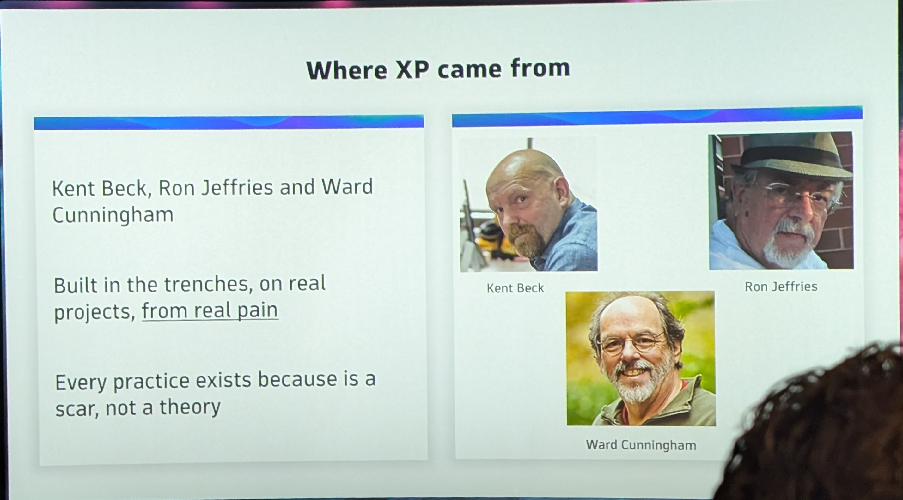

### 09:00
- #1 TDD

### 10:00
- green test Broken behaviour

### 13:50

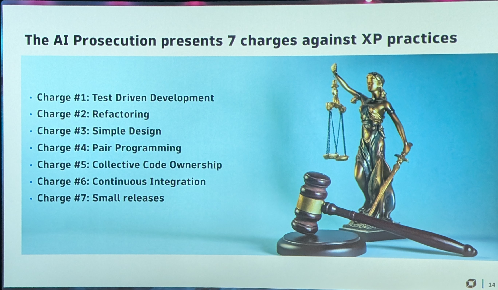

### 15:00
- SDD give The Behaviour

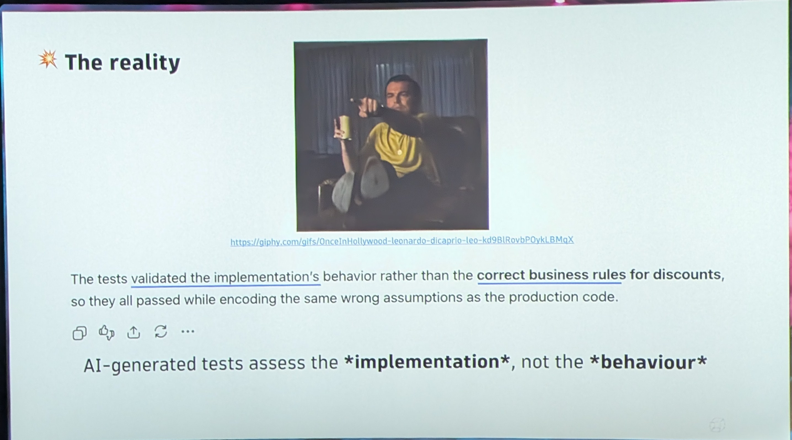

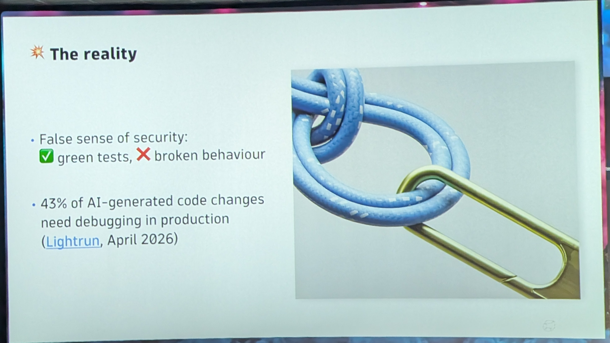

### 19:43

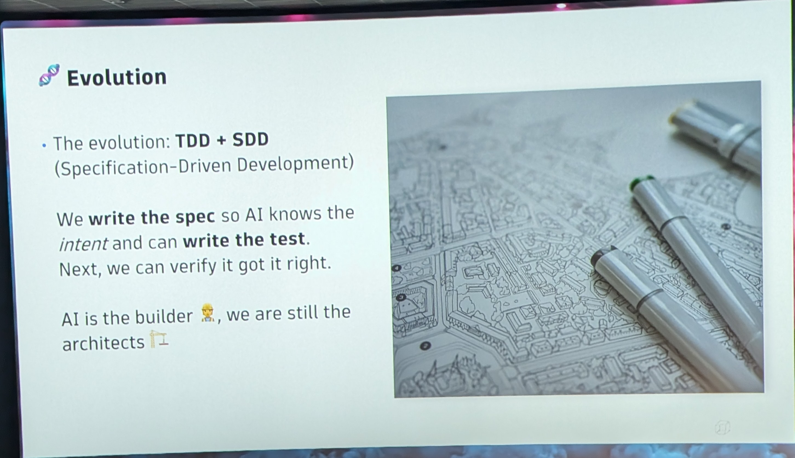

### 20:00
- #2 Refactoring

### 23:37

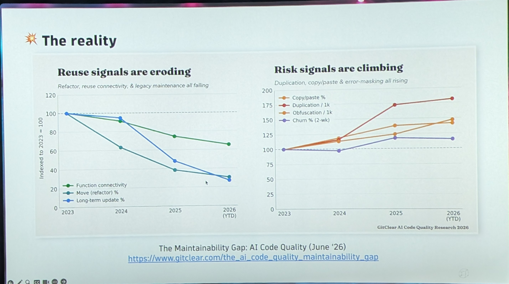

### 28:00
- #3 simple Design

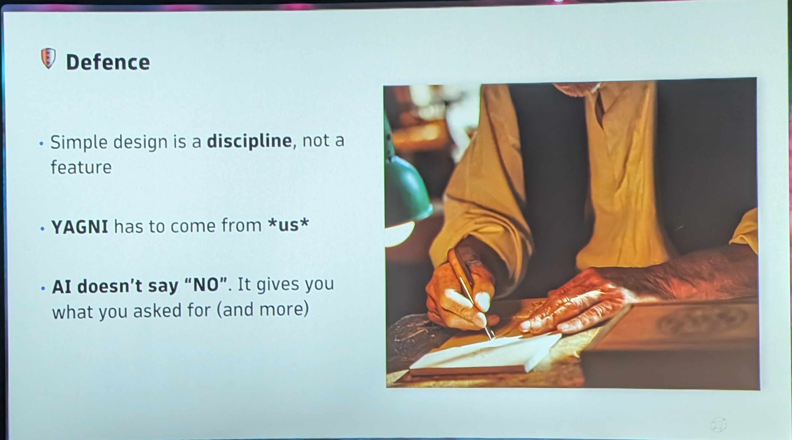

### 31:00 [?]
- #4 pair programming

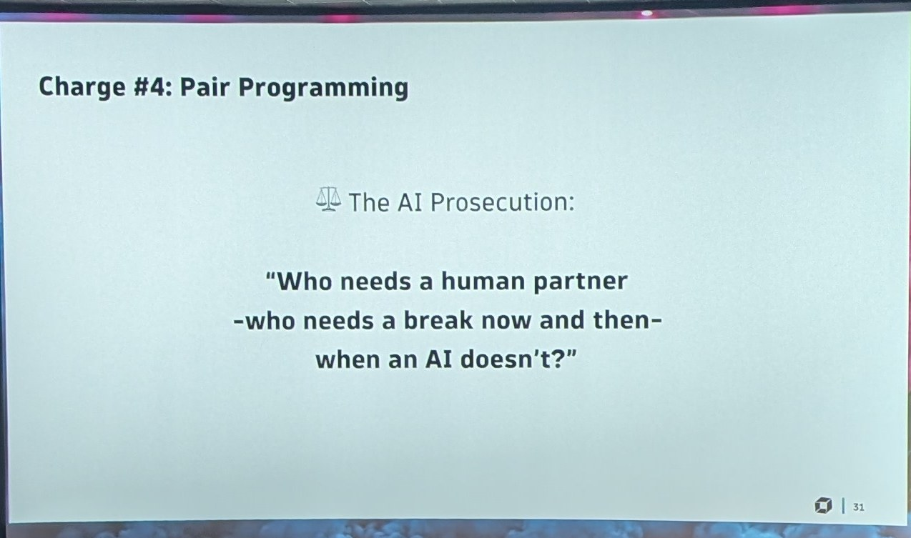

### 34:01

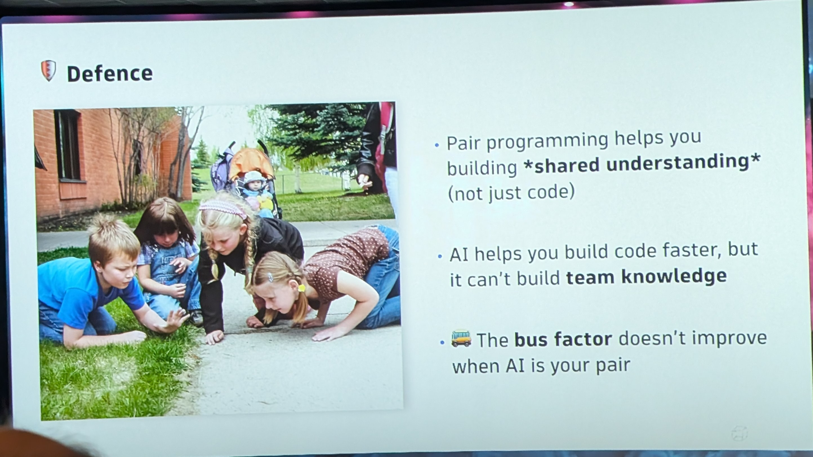

### 36:00
- #5 collective ownership

### 43:46

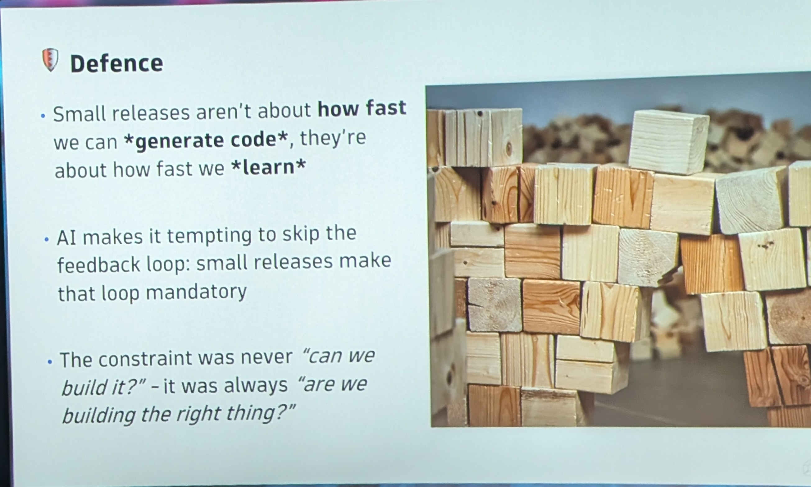
