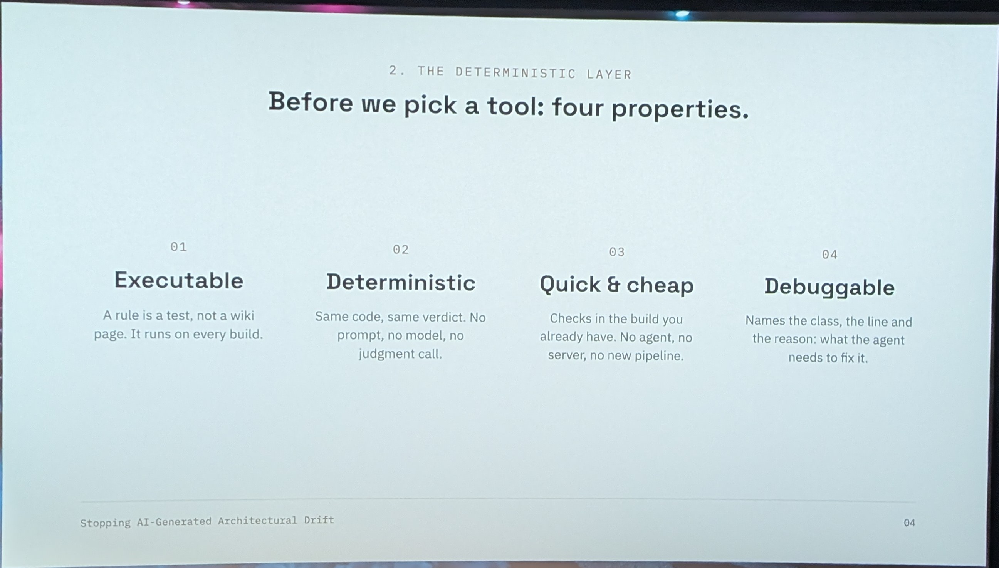
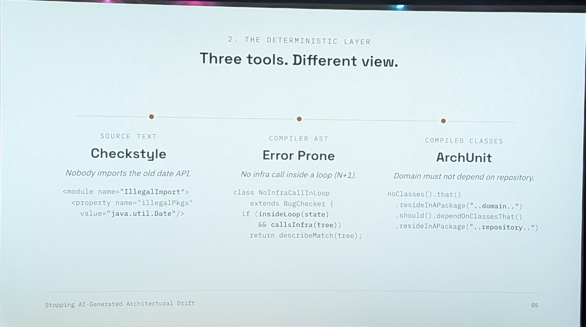

<a class="video-button" href="https://youtu.be/K3kD89Y1YCk" target="_blank" rel="noopener">▶ Watch the video</a>

[Stopping AI-Generated Architectural Drift: Deterministic Guardrails for Agentic Coding](https://m.devoxx.com/events/dvbe26/talks/5507/stopping-ai-generated-architectural-drift-deterministic-guardrails-for-agentic-coding) by [Sasha Podlesniuk](https://m.devoxx.com/events/dvbe26/speaker/5807/sasha-podlesniuk)  
Room 8 · Tools-in-Action · 17:35-18:05

## Summary

This talk explains how to prevent AI-generated code from spreading architectural violations by using layered guardrails. It shows why natural-language rules fail, and how deterministic enforcement with ArchUnit, custom linters, and CI gates can stop bad patterns immediately and make higher-level rules effective.

## Key points ⭐

- 03:41 error pron, java check like arch unit

## Timeline

### [02:29](https://youtu.be/K3kD89Y1YCk?t=149)


### [03:41](https://youtu.be/K3kD89Y1YCk?t=221) ⭐
- error pron
  - java check like arch unit



## Extra notes

https://www.youtube.com/@AriKuschnir


Both do static analysis of Java code, but they don't work at the same moment, at the same level, or on the same kind of problem. They are complementary.

## ArchUnit: checking the architecture

ArchUnit is a test library. You write architecture rules as JUnit tests, which run during the test phase. It analyses the compiled bytecode (the `.class` files) and builds a graph of all classes and their dependencies. So it has a global view of the codebase: who depends on whom, which packages call each other, which annotations are where.

Typical questions are structural:

- "The service layer must never call the web layer."
- "No cycles between packages."
- "Classes annotated `@Stateless` must live in `..ejb..`."
- "Nobody uses `java.util.Date` outside the legacy module."

```java
@ArchTest
static final ArchRule services_ne_dependent_pas_du_web =
    noClasses().that().resideInAPackage("..service..")
        .should().dependOnClassesThat().resideInAPackage("..web..");
```

A big asset for a monolith: `FreezingArchRule`. It records the existing violations as a baseline and only fails the build on new ones. So you can enforce a rule on legacy code without fixing everything first.

## Error Prone: finding bugs in the code

Error Prone, developed by Google, is a plugin for the `javac` compiler. It runs during compilation and analyses the AST (syntax tree) of each source file. Its view is local and fine-grained: it looks at expressions, method calls and precise types, but file by file, with no overall view of the architecture.

Typical questions are about programming mistakes:

- `String.format` with a number of arguments that doesn't match the pattern;
- ignored return value (`str.trim();` on its own);
- `equals` between incompatible types;
- non-exhaustive `switch`, misuse of `Optional`, concurrency problems, etc.

```java
String s = "abc";
s.replace("a", "b"); // Error Prone: ReturnValueIgnored → compilation error
```

It often suggests an automatic fix (patch) and is the base for other tools, like NullAway for nullability. Writing your own checks with the `BugChecker` API is possible, but much more complex than an ArchUnit rule.

## In short

||ArchUnit|Error Prone|
|---|---|---|
|Nature|Test library|javac compiler plugin|
|When|Test phase|Compilation|
|Analysis|Bytecode, global graph|Source AST, local per file|
|Target|Architecture rules and conventions|Bugs and bad code patterns|
|Custom rules|Easy (fluent Java DSL)|Possible but more technical|
|Legacy|Native freeze / baseline|Disable per check or suppression|

The simple rule: **ArchUnit answers "is this code in the right place and does it respect the intended structure?", Error Prone answers "does this code do what the developer thinks?"** On a Java EE monolith, the two together cover the ground well.

Setup-wise, ArchUnit is trivial to add (one test dependency). Error Prone needs more configuration of the `maven-compiler-plugin`. Since JDK 16 you also need `--add-exports` / `-J--add-opens` flags, and you must check the compatibility between the Error Prone version and the JDK version.
